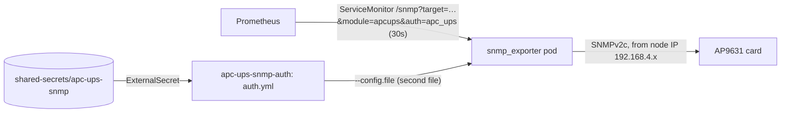

# apc-ups-exporter

Prometheus metrics for APC Smart-UPS units, via [snmp_exporter](https://github.com/prometheus/snmp_exporter)
and its stock `apcups` module. Deployed by ArgoCD (manual sync) from this
directory; the upstream `prometheus-snmp-exporter` chart is pinned in
`Chart.yaml`.

- **Dashboard:** Grafana → *APC UPS Overview* (`/d/apc-ups-overview`), shipped
  as a ConfigMap from `files/apc-ups-grafana-dashboard.json`.
- **Metrics:** `ups*` series with `target="<name>"` (e.g. `apc01`) and
  `instance="<card IP>"`. `upsBasicOutputStatus{upsBasicOutputStatus="onLine"} == 1`
  is the "on line power" check; `upsCommStatus_ok` confirms the card can talk
  to the UPS.

## Devices

| Name | Card IP | Card | Firmware | UPS |
|-|-|-|-|-|
| apc01 | `192.168.4.14` (static) | AP9631 (NMC2, hw rev 05, 2013) | AOS / sumx v6.4.0 (2015) | Smart-UPS (SMX family, internal `APCRBC115`, external pack `SMX48RMBP2U`) |

apc01 was bought used. It arrived configured for its previous owner (static
`10.160.184.15`, SNMP restricted to four foreign 10.x hosts, HTTP disabled), and
was reconfigured on 2026-11-19 as described below.

## How it works



- The SNMP community lives only in the `apc-ups-snmp` secret (key
  `community`) in the `shared-secrets` namespace, created by hand:

  ```sh
  kubectl -n shared-secrets create secret generic apc-ups-snmp --from-literal=community=<community>
  ```

  `templates/externalsecret.yaml` renders it into an `auth.yml` that is passed
  to snmp_exporter as a second `--config.file`, layered over the image's stock
  `snmp.yml`.
- **Why not an env var:** `--config.expand-environment-variables` only expands
  SNMPv3 `username`, `password` and `priv_password`. A `${VAR}` in `community`
  is sent literally, and every scrape times out.
- A full `apcups` walk of the AP9631 takes ~3.2s, so the ServiceMonitor uses a
  30s interval and 20s timeout.

## Card configuration

### Getting a shell

The card's web UI is not usable: HTTP is disabled (every page returns 403
"Protected Object"), and HTTPS resets every TLS handshake (likely a missing or
broken certificate). Use SSH. The card only offers `ssh-rsa` host keys and
`aes256-cbc`/`3des-cbc`, which Fedora's crypto policy refuses even with `+`
options, so connect from a container:

```sh
docker run --rm -it alpine:3.20 sh -c 'apk add -q openssh-client && ssh -o HostKeyAlgorithms=+ssh-rsa -o Ciphers=+aes256-cbc -o StrictHostKeyChecking=no -o UserKnownHostsFile=/dev/null apc@192.168.4.14'
```

To get the web UI back, `web -h enable` turns HTTP back on.

### SNMP access control

SNMPv1/v2c is enabled with a read-only community. The card has four access
slots (`snmp` with no arguments prints them):

| Slot | Address | Purpose |
|-|-|-|
| 1 | `192.168.4.255` | Whole `192.168.4.0/24` (`.255` = any host on the /24). Pods reach the card from their node's IP, so this covers the exporter on any node. |
| 2 | `10.73.10.177` | Workstation, for testing over the SD-WAN. Safe to drop with `snmp -a2 disable`. |
| 3, 4 | — | Disabled (previous owner's entries). |

Gotchas seen on AOS v6.4.0:

- `snmp -c<n> <community>` prints `E000: Success` even when it ignores the
  value. A 15-character community was silently rejected; a 12-character
  lowercase+digits one worked. Always re-run `snmp` and check the
  `Community:` line after changing it.
- The community applies per slot, so set it on every slot in use.

### Network

Static IP set from the CLI:

```
boot -b manual
tcpip -i 192.168.4.14 -s 255.255.255.0 -g 192.168.4.1
reboot
```

`reboot` restarts only the management card; the UPS keeps powering its load.

## Adding another APC card

1. On the card: set the same community on a slot whose address is
   `192.168.4.255`, and make sure the card is on `192.168.4.0/24`.
2. Add a `name`/`target` entry under `prometheus-snmp-exporter.serviceMonitor.params`
   in `values.yaml`, push, and sync in ArgoCD.
3. Check `upsCommStatus_ok{target="<name>"}` in Prometheus.

A rack PDU (rPDU firmware) is not covered by the `apcups` module; it would need
a generated module from the PowerNet-MIB `rPDU2` tables.

## Follow-ups

- Card firmware is v6.4.0 (2015). Later AOS 6.x releases for the AP9631 carry
  security fixes.
